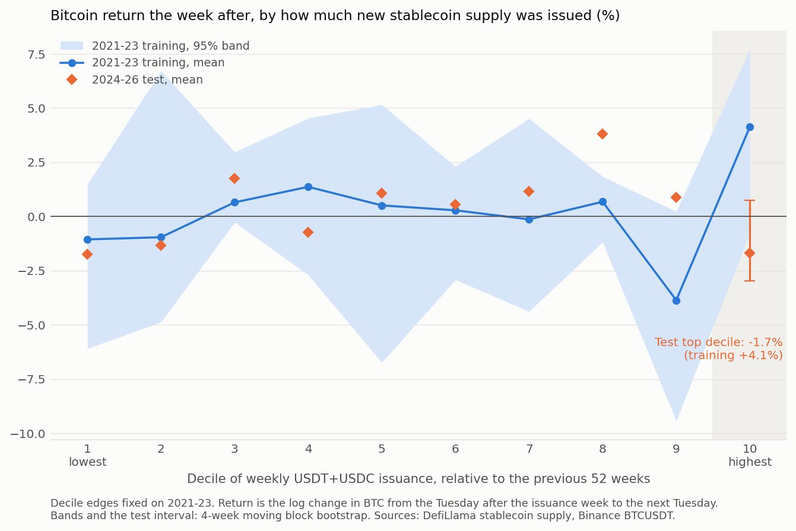

# Does a big week of stablecoin issuance predict bitcoin's next week?

A popular story in crypto goes like this: when Tether and Circle mint a lot of new USDT and USDC, fresh dollars are about to buy bitcoin, so the price goes up. The supply numbers are public and free, so if the story were true and large enough to matter, anyone could trade on it.

I tested it. I wrote the hypotheses, data rules and pass lines in [PLAN.md](PLAN.md) and committed them on 13 November 2026 before running any test. I fixed the threshold on 2021-2023 data and committed it separately, also before the test. 2024 to October 2026 is the test period.

The write-up is on my site: [Does a big week of stablecoin issuance predict bitcoin's next week?](https://bykobuteyko.com/research/stablecoin-issuance/)



## Results (test period, 148 weeks, January 2024 to October 2026)

**No.** In the 20 test weeks with the most issuance relative to the previous year, bitcoin returned -1.7% on average the following week. In the other 128 weeks it returned +0.6%. The difference is -2.3 percentage points (95% block bootstrap interval -4.4 to +0.5), the wrong sign for the hypothesis.

| Hypothesis | Verdict |
|---|---|
| H1. Top-10% issuance weeks are followed by higher bitcoin returns | Not supported (one-sided p = 0.94) |
| H2 (secondary). The effect survives controlling for this week's and last week's bitcoin return | Not supported (p = 0.34) |

In 2021-2023, the period where I set the threshold, the same comparison came out at +4.4 percentage points with p = 0.04. It looks like a signal there, and it is gone out of sample. The chart shows why I don't trust the training number anyway: the top decile sits at +4.1% right next to a ninth decile at -3.9%. Nothing between deciles 2 and 9 looks like a trend, so a single spike in one decile is what you would expect from noise in 16 weeks each.

My written prediction was that H1 would fail with a difference between -1 and +1 percentage points. The verdict was right; the size was not. -2.3 is outside that range, though its interval includes zero.

**Issuance follows price.** This was a description, not a test, and it was the one clear pattern. A 10% bitcoin gain in a week adds about 0.6 to the following week's issuance score in 2024-2026 (p = 0.006), and the week three back also matters. Bitcoin's past three weekly returns explain 11% of the variation in issuance in the test period and 4% in 2021-2023. This fits Griffin and Shams (2020), who found Tether flows timed around bitcoin moves in 2017-2018. Big mints tend to come after rallies. They have not been a sign of more to come.

**H2.** With this week's and last week's return in the regression, the issuance coefficient is +0.2 percentage points of next-week return per unit of the signal, with a standard error of 0.5. There is nothing left to explain.

## Robustness

None of these changes a verdict; I listed all of them in the plan before the test.

| Variant | Top weeks | Difference | p |
|---|---|---|---|
| Main test | 20 | -2.31% | 0.94 |
| No one-day gap between issuance week and return week | 20 | +0.07% | 0.44 |
| Supply smoothed with a 3-day median | 20 | -1.00% | 0.65 |
| USDT only | 23 | -1.51% | 0.81 |
| USDC only | 22 | +0.55% | 0.28 |
| Top 20% instead of top 10% | 33 | -1.27% | 0.82 |
| Threshold in raw dollars (above $2.28bn a week) | 24 | -2.09% | 0.93 |
| Coinbase BTC-USD instead of Binance BTCUSDT | 20 | -2.35% | 0.94 |

Shifting the return window by a single day moves the result from -2.3 to +0.1 points. That is how noisy 20 weekly observations are when bitcoin's weekly standard deviation is about 6.7%.

## What this test can and cannot say

With 20 top weeks against 128 others, the smallest effect this design detects reliably is about 3.5 to 4 percentage points a week. So a fail rules out the strong version of the story: "big mint weeks are reliably followed by big up weeks". It cannot rule out an edge of half a point a week. Nothing in the data hints at one, but a test this size wouldn't see it.

The signal compares each week's supply growth with the previous 52 weeks (median and median absolute deviation). A fixed growth threshold would not work: combined USDT and USDC supply went from about $4bn to $117bn between January 2020 and January 2022, and no week since 2024 comes close to the growth rates of that period.

## Data and pitfalls

- Supply: [DefiLlama stablecoins API](https://stablecoins.llama.fi), daily circulating supply of USDT and USDC at the asset level. Circulating excludes what DefiLlama calls unreleased: supply Tether has minted into its own treasury but not issued yet. A treasury mint counts as issuance only when the coins leave the treasury.
- Prices: Binance BTCUSDT daily closes, with Coinbase BTC-USD as a check.
- I don't sum the per-chain series. Several chains enter DefiLlama's per-chain data on 12 May 2022 with billions already on them, and Tether's chain swaps (burn on Ethereum, mint on Tron) show up as large opposite moves. The asset-level total has neither problem. This is also why I did not compare Tron and Ethereum mints.
- DefiLlama's USDT history before 2020 is incomplete ($0.03bn on 1 January 2019, against roughly $2bn in reality), so the sample starts in 2020 and the first year only feeds the trailing window.
- The USDC run in March 2023 and the Terra collapse in May 2022 are large negative weeks in the training period. They don't affect the top-decile threshold.

Full list in [PLAN.md](PLAN.md).

## Reproduce

```bash
pip install -r requirements.txt
python fetch.py
python thresholds.py
python analysis.py
python chart.py
```

`fetch.py` writes raw files to `data/` (not committed) and prints their hashes. `analysis.py` prints what is in [results.txt](results.txt). DefiLlama can revise history, so a later run may differ slightly.

## References

- Griffin, J. M. and Shams, A. (2020). Is Bitcoin Really Untethered? *Journal of Finance* 75(4).
- Wei, W. C. (2018). The impact of Tether grants on Bitcoin. *Economics Letters* 171.
