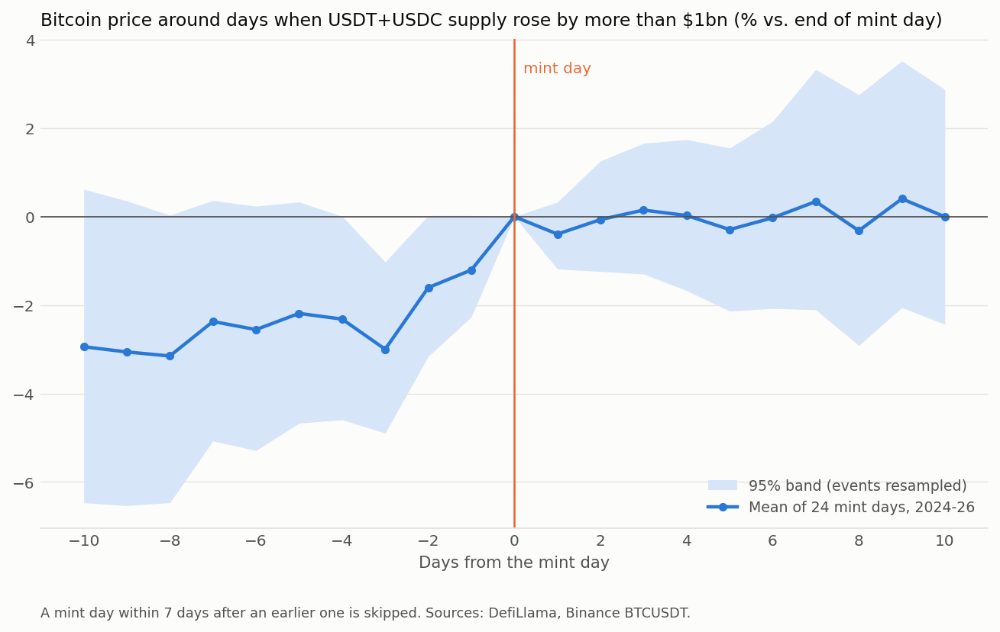

# Does a big week of stablecoin issuance predict bitcoin's next week?

A popular story in crypto goes like this: when Tether and Circle mint a lot of new USDT and USDC, fresh dollars are about to buy bitcoin, so the price goes up. The supply numbers are public and free, so if the story were true and large enough to matter, anyone could trade on it.

I tested it. I wrote the hypotheses, data rules and pass lines in [PLAN.md](PLAN.md) and committed them on 13 November 2026 before running any test. I fixed the threshold on 2021-2023 data and committed it separately, also before the test. 2024 to October 2026 is the test period.

The write-up is on my site: [Does a big week of stablecoin issuance predict bitcoin's next week?](https://bykobuteyko.com/research/stablecoin-issuance/)


## Results (test period, 148 weeks, January 2024 to October 2026)

**No.** In the 20 test weeks with the most issuance relative to the previous year, bitcoin returned -1.7% on average the following week. In the other 128 weeks it returned +0.6%. The difference is -2.3 percentage points (95% block bootstrap interval -4.4 to +0.5), the wrong sign for the hypothesis.

| Hypothesis | Verdict |
|---|---|
| H1. Top-10% issuance weeks are followed by higher bitcoin returns | Not supported (one-sided p = 0.94) |
| H2 (secondary). The effect survives controlling for this week's and last week's bitcoin return | Not supported (p = 0.34) |

In 2021-2023, the period where I set the threshold, the same comparison came out at +4.4 percentage points with p = 0.04. It looks like a signal there, and it is gone out of sample. The chart shows why I don't trust the training number anyway: the top decile sits at +4.1% right next to a ninth decile at -3.9%. Nothing between deciles 2 and 9 looks like a trend, so a single spike in one decile is what you would expect from noise in 16 weeks each.

My written prediction was that H1 would fail with a difference between -1 and +1 percentage points. The verdict was right; the size was not. -2.3 is outside that range, though its interval includes zero.

**Issuance follows price.** This was a description, not a test, and it was the one clear pattern. A 10% bitcoin gain in a week adds about 0.6 to the following week's issuance score in 2024-2026 (p = 0.006), and the week three back also matters. Bitcoin's past three weekly returns explain 11% of the variation in issuance in the test period and 4% in 2021-2023. This fits Griffin and Shams (2020), who found Tether flows timed around bitcoin moves in 2017-2018. Big mints tend to come after rallies. They have not been a sign of more to come.

**H2.** With this week's and last week's return in the regression, the issuance coefficient is +0.2 percentage points of next-week return per unit of the signal, with a standard error of 0.5. There is nothing left to explain.

## Robustness

None of these changes a verdict; I listed all of them in the plan before the test.

| Variant | Top weeks | Difference | p |
|---|---|---|---|
| Main test | 20 | -2.31% | 0.94 |
| No one-day gap between issuance week and return week | 20 | +0.07% | 0.44 |
| Supply smoothed with a 3-day median | 20 | -1.00% | 0.65 |
| USDT only | 23 | -1.51% | 0.81 |
| USDC only | 22 | +0.55% | 0.28 |
| Top 20% instead of top 10% | 33 | -1.27% | 0.82 |
| Threshold in raw dollars (above $2.28bn a week) | 24 | -2.09% | 0.93 |
| Coinbase BTC-USD instead of Binance BTCUSDT | 20 | -2.35% | 0.94 |

Shifting the return window by a single day moves the result from -2.3 to +0.1 points. That is how noisy 20 weekly observations are when bitcoin's weekly standard deviation is about 6.7%.

## Further checks (exploratory)

After the verdicts I wanted to know whether the null holds up from other angles: a second data source, other horizons, daily data, the whole stablecoin market, ether. I listed eleven checks in [PLAN.md](PLAN.md) on 14 November 2026 before running any of them. With eleven tries, one could pass by luck, so each p-value comes with a Holm-adjusted one across all eleven. None of them changes the H1 or H2 verdict. Full output: [results_explore.txt](results_explore.txt).

| Check | Result | p | Holm p |
|---|---|---|---|
| E1. Supply from CoinMetrics instead of DefiLlama (includes Tether's treasury stock) | -0.68% | 0.52 | 1.00 |
| E2a. Return over the next two weeks | -1.86% | 0.79 | 1.00 |
| E2b. Return over the next four weeks | -1.12% | 0.65 | 1.00 |
| E3. Straight-line slope of next-week return on the issuance score | +0.11 pp per unit | 0.40 | 1.00 |
| E4. All weeks 2021-2026, training years included | +0.75% | 0.37 | 1.00 |
| E5. Heavy redemption weeks (bottom 10%), predicted lower | -2.37% | 0.05 | 0.54 |
| E6. Daily: issuance score against the return two days later | +0.10 pp per unit | 0.007 | 0.08 |
| E7. All stablecoins, not just USDT and USDC | -1.38% | 0.79 | 1.00 |
| E8. Days with a mint above $1bn, return over the following week | -0.25% | 0.60 | 1.00 |
| E9. Heavy weeks in up-trends minus heavy weeks in down-trends | -1.19% | 0.74 (two-sided) | 1.00 |
| E10. Ether instead of bitcoin | -1.66% | 0.89 | 1.00 |

**The data source is not the problem.** CoinMetrics and DefiLlama weekly supply growth correlate at 0.81 in the test period and agree on 95% of weeks about whether a week is in the top 10%.

**Daily issuance (E6) is the one result near the line, and I don't believe it.** After seeing it I ran checks I had not listed in advance, so treat them as post-hoc. The effect exists only at the exact timing I chose. If the return window starts a day earlier (no gap) or a day later, the coefficient drops to almost zero (+0.007 and +0.013 pp, p around 0.4). In 2021-23 it has the wrong sign, and within the test period it comes from 2024 alone. A real flow effect would not depend on one specific day's offset. Controlling for past returns or winsorising the score doesn't move it, which rules out momentum and outliers but not chance.

**Redemptions (E5)** point the expected way, -2.4 points after heavy redemption weeks, but at p = 0.05 out of eleven tries it is not evidence.

**By year (E11):** the gap was -4.5 points in 2024 (14 heavy weeks) and -1.0 in 2025 (6 heavy weeks). No week in 2026 reached the threshold, because combined supply has drifted sideways to lower this year. So the test really covers 2024 and 2025.



**Mints come after rallies.** Around the 24 test-period days when USDT and USDC supply rose by more than $1bn, bitcoin had climbed about 3% over the previous ten days, almost all of it in the last three. Afterwards the average path is flat. In 2021-23 the 21 such days show the same climb before and a decline of about 4.7% over the ten days after. Daily data repeats it: bitcoin's returns over the previous seven days jointly predict daily issuance (p = 0.0001). Large mints look like a response to price, not a cause of it.

## What this test can and cannot say

With 20 top weeks against 128 others, the smallest effect this design detects reliably is about 3.5 to 4 percentage points a week. So a fail rules out the strong version of the story: "big mint weeks are reliably followed by big up weeks". It cannot rule out an edge of half a point a week. Nothing in the data hints at one, but a test this size wouldn't see it.

The signal compares each week's supply growth with the previous 52 weeks (median and median absolute deviation). A fixed growth threshold would not work: combined USDT and USDC supply went from about $4bn to $117bn between January 2020 and January 2022, and no week since 2024 comes close to the growth rates of that period.

## Data and pitfalls

- Supply: [DefiLlama stablecoins API](https://stablecoins.llama.fi), daily circulating supply of USDT and USDC at the asset level. Circulating excludes what DefiLlama calls unreleased: supply Tether has minted into its own treasury but not issued yet. A treasury mint counts as issuance only when the coins leave the treasury.
- Prices: Binance BTCUSDT daily closes, with Coinbase BTC-USD as a check. Ether from Binance ETHUSDT.
- Exploratory sources: [CoinMetrics community API](https://docs.coinmetrics.io/api/v4/) (`SplyCur`) and DefiLlama's total stablecoin supply.
- I don't sum the per-chain series. Several chains enter DefiLlama's per-chain data on 12 May 2022 with billions already on them, and Tether's chain swaps (burn on Ethereum, mint on Tron) show up as large opposite moves. The asset-level total has neither problem. This is also why I did not compare Tron and Ethereum mints.
- DefiLlama's USDT history before 2020 is incomplete ($0.03bn on 1 January 2019, against roughly $2bn in reality), so the sample starts in 2020 and the first year only feeds the trailing window.
- The USDC run in March 2023 and the Terra collapse in May 2022 are large negative weeks in the training period. They don't affect the top-decile threshold.

Full list in [PLAN.md](PLAN.md).

## Reproduce

```bash
pip install -r requirements.txt
python fetch.py
python thresholds.py
python analysis.py
python explore.py
python posthoc_e6.py
python chart.py
```

`fetch.py` writes raw files to `data/` (not committed) and prints their hashes. `analysis.py` prints what is in [results.txt](results.txt); `explore.py` and `posthoc_e6.py` print what is in [results_explore.txt](results_explore.txt). DefiLlama can revise history, so a later run may differ slightly.

## References

- Griffin, J. M. and Shams, A. (2020). Is Bitcoin Really Untethered? *Journal of Finance* 75(4).
- Wei, W. C. (2018). The impact of Tether grants on Bitcoin. *Economics Letters* 171.
